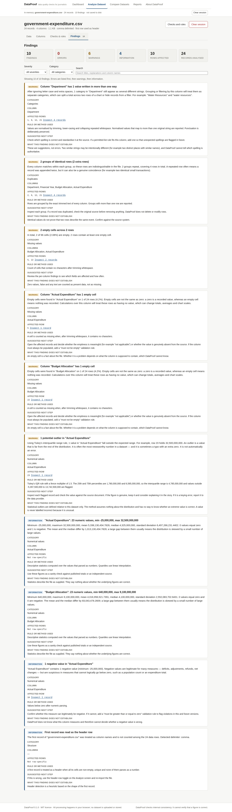
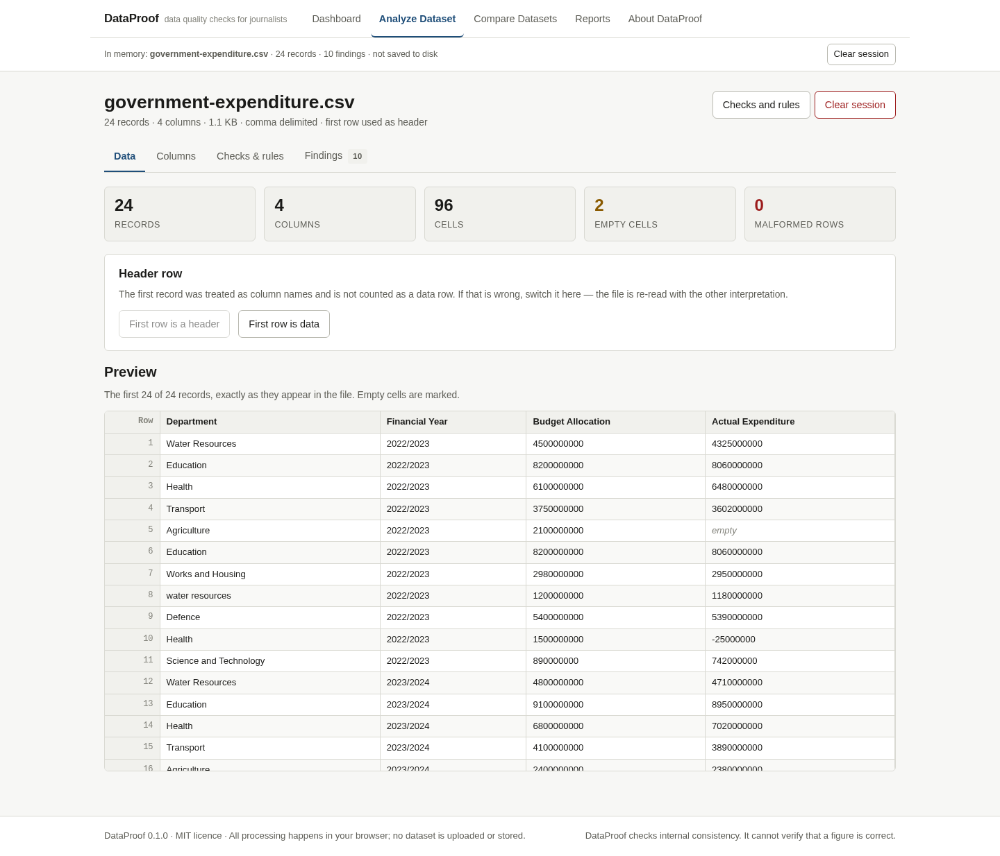

# DataProof

**An open-source data quality tool for journalists.**

DataProof examines a CSV dataset for the problems that lead to published corrections —
empty cells, repeated records, the same category spelled several ways, dates that do
not parse, totals that do not add up, and figures that changed between releases.

It runs entirely in the browser. There is no backend, no account, no API key and no
upload. Your dataset never leaves your computer.

```
Dashboard  ·  Analyze Dataset  ·  Compare Datasets  ·  Reports  ·  About DataProof
```



---

## Contents

- [The problem it addresses](#the-problem-it-addresses)
- [Who should use it](#who-should-use-it)
- [What it currently supports](#what-it-currently-supports)
- [What makes the workflow useful](#what-makes-the-workflow-useful)
- [Installation and usage](#installation-and-usage)
- [Supported file formats](#supported-file-formats)
- [Privacy and data handling](#privacy-and-data-handling)
- [Testing and development](#testing-and-development)
- [Known limitations](#known-limitations)
- [Validation is not verification](#validation-is-not-verification)
- [Future development](#future-development)
- [How to contribute](#how-to-contribute)
- [Related tools](#related-tools)
- [Licence](#licence)

---

## The problem it addresses

Public expenditure figures, election results, population statistics, government
contracts and economic indicators are usually published as CSV files. Those files
are produced by people, exported from systems that were designed for something
else, and revised without warning.

The failure modes are predictable:

- a record appended twice during a merge;
- an empty cell where a figure should be, which silently drops a row from a total;
- `Lagos`, `lagos` and `LAGOS` counted as three different places;
- a date column where half the values are `DD/MM/YYYY` and half are `MM/DD/YYYY`;
- a figure with an extra digit;
- a total that no longer matches the sum of its components;
- a revised release where a number changed and nobody said why.

Each of these has caused a correction, a clarification or a retracted chart. Finding
them by eye across tens of thousands of rows is slow, and the checks that would catch
them are easy to forget under deadline.

DataProof runs those checks in a fixed order, explains each result in plain language,
and produces a report that can be filed with the story.

## Who should use it

- **Reporters and data journalists** who have just received a file and need to know
  what is wrong with it before they build anything on top of it.
- **Editors** who want a short, readable record of what was checked before a story
  was published.
- **Researchers and NGO analysts** working with public datasets who want the same
  checks without setting up a data pipeline.
- **Students** learning how datasets fail in practice.

You do not need to know SQL, Python or R. You do not need to install anything.

## What it currently supports

| Area | What DataProof does |
| --- | --- |
| **Import** | CSV and plain text; comma, semicolon, tab and pipe delimiters; UTF-8 with or without a BOM; quoted fields, embedded commas and embedded newlines; header-row detection you can override; malformed-record detection; column-type detection you can override |
| **Missing values** | Empty cells per column and per row, with counts, percentages and the affected record numbers |
| **Duplicates** | Exactly identical rows, and rows that match on columns you select, with the matching values shown |
| **Categories** | Values that differ only by case or whitespace, reported as suggestions with the original values preserved |
| **Dates** | Every value checked against one format you choose; impossible dates and mismatched values reported; ambiguous dates flagged, never resolved |
| **Numbers** | Count, min, max, mean, median, standard deviation, quartiles; values that cannot be parsed; negatives; zeros; outliers by IQR or z-score |
| **Rules you define** | Required field, numeric range, unique values, permitted list, non-negative |
| **Cross-field checks** | A total compared with the sum of its components, with an explicit formula and a tolerance |
| **Dataset comparison** | Column additions, removals and type changes; records added, removed and changed; before-and-after values; identifier-based or positional matching |
| **Reports** | JSON for machines, self-contained HTML for people, both including methods, assumptions and limitations |

Every finding carries: a short title, a plain-language explanation, the affected
columns, the affected row numbers, the rule or statistical method used, a suggested
next step, and — where the evidence does not support certainty — an explicit
statement of what the finding does **not** establish.



## What makes the workflow useful

Most tools that check data either validate it against a schema you have to write
first, or profile it and hand you a wall of statistics. DataProof is built around a
different set of decisions:

**It distinguishes a structural problem from an unusual value.** A missing value is
detectable. A duplicate row is a *potential* duplicate. A large number is an
*anomaly requiring investigation*, not a mistake. A percentage above 100 may be
perfectly valid. A zero is a recorded value, never a blank. The severity levels mean
something specific:

- **Error** — a rule that was explicitly defined has been violated. Either you wrote
  the rule, or the data contradicts a date format you selected. This is the only way
  a finding becomes an error.
- **Warning** — something requires investigation. Missing cells, duplicate groups,
  category variants, unreadable dates and outliers all land here.
- **Information** — a useful observation that is not necessarily a problem.

**Nothing is ever modified.** DataProof does not merge categories, repair dates,
delete duplicates or rewrite values. It reports, and it points at the original
records. Every finding links to the exact rows, shown with their original values.

**The uncertainty is written down.** A finding about a statistical outlier says, in
the finding itself, that outliers are defined relative to this dataset only and that
a value is never labelled incorrect for being unusual. A comparison that had to fall
back on row position says, in the result, that this is the single most likely source
of a misleading conclusion.

**The report is meant to be filed.** Every export records the file name, its
dimensions, the delimiter, whether the first row was treated as a header, the checks
that ran, the statistical method and its threshold, the rules that were defined, and
the known limitations — alongside the statement that the report is not proof that the
data is accurate.

## Installation and usage

### Requirements

- Node.js 20 or later (Node 24 is what the project is developed against)
- npm 10 or later

### Run it locally

```bash
git clone https://github.com/your-org/dataproof.git
cd dataproof
npm install
npm run dev
```

Open the address printed by Vite (by default `http://localhost:5173`).

### Production build

```bash
npm run build      # type-check, then bundle into dist/
npm run preview    # serve the built bundle at http://127.0.0.1:4173
```

`dist/` is a folder of static files. Copy it to any static host — GitHub Pages,
Netlify, an S3 bucket, an internal web server — or open it from a USB stick. There is
no server component and no configuration.

### Using it

1. **Dashboard** — read what the tool does, or open a sample dataset.
2. **Analyze Dataset** — import a CSV by clicking or dragging it onto the drop zone.
   The file is parsed, profiled and checked immediately.
   - *Data* shows the dimensions, anything that went wrong while reading the file,
     and a preview of the records.
   - *Columns* shows the detected type for each column. Correct any that are wrong,
     and choose a date format for date columns.
   - *Checks & rules* is where you set the duplicate matching key, the outlier
     method, your own validation rules and any cross-field comparisons. Press
     **Run checks**.
   - *Findings* groups the results by severity and category, with filters and a
     search box. Any finding can be opened to show the records behind it.
3. **Compare Datasets** — load an older and a newer version of the same file. Choose
   the columns that identify a record, then compare.
4. **Reports** — export the analysis as JSON or HTML. Decide whether record values
   should be included.
5. **Clear session** — removes the dataset, settings and findings from memory.

### Working offline

The built application has no runtime network dependencies. After `npm run build` it
works with no internet connection at all.

## Supported file formats

**Supported**

- CSV and plain-text files saved as UTF-8, with or without a byte-order mark.
- Comma, semicolon, tab and pipe delimiters. The delimiter is detected by scoring how
  consistently each candidate splits the first lines into the same number of fields.
- Quoted fields using `"`, including embedded delimiters, embedded line breaks and
  doubled quotes (`""`) for a literal quote.
- LF, CRLF and CR line endings.
- A header row, or no header row.

**Not supported — and not claimed to be**

- Excel workbooks (`.xlsx`, `.xls`). Save as **CSV UTF-8** in Excel first.
- PDFs, scanned documents, images, or any form of OCR.
- Legacy encodings such as Windows-1252 or Latin-1. Text may be mangled.
- Fixed-width or multi-record-per-line formats.
- Files larger than 60 MB (see [Known limitations](#known-limitations)).

## Privacy and data handling

This is a design constraint, not a setting.

- **No upload.** Files are read with the browser's File API and parsed in the tab.
  There is no backend to upload to.
- **No network calls at runtime.** The built application is static files.
- **No persistent storage.** The dataset, the settings and the findings live in
  JavaScript memory. Nothing is written to disk, cookies, `localStorage` or
  IndexedDB. Closing the tab clears everything, and **Clear session** clears it
  immediately.
- **No console logging of data.** Dataset values are never written to the developer
  console.
- **No analytics.** Nothing collects dataset contents, and there is no telemetry of
  any kind.
- **No code execution.** Spreadsheet formulas and user-supplied code are never
  evaluated. Cross-field comparisons use a structured builder, not an expression
  parser.
- **Escaped output.** Every dataset value that reaches an HTML report passes through
  an HTML escaper. A cell containing `<script>` is displayed as text.
- **Reports are opt-in about values.** By default a report reproduces no records from
  the dataset — only row numbers and aggregate results. Individual findings quote a
  small number of example values (up to 20) so that each one can be understood and
  checked. Enabling *include record values* adds the full rows and puts a privacy
  notice on the face of the report.

Full detail: [`docs/PRIVACY.md`](docs/PRIVACY.md).

## Testing and development

```bash
npm test           # unit and component tests (Vitest), 157 tests
npm run test:watch # same, in watch mode
npm run test:e2e   # browser tests (Playwright) against the production build
npm run typecheck  # TypeScript, no emit
npm run build      # production build
```

The browser tests need a Chromium download once:

```bash
npx playwright install chromium
```

### Source layout

```
src/
  lib/                 Pure, testable logic — no React, no DOM
    csv.ts             Parsing, delimiter and header detection, value interpretation
    profile.ts         Column profiling and date-format suggestion
    analyze.ts         Runs every check and assembles the result
    compare.ts         Dataset comparison
    checks/            One module per check family
    report/            JSON and HTML report generation
    sampleData.ts      The fictional sample datasets
  components/          Reusable interface pieces
  pages/               One module per navigation entry
  state/session.tsx    Session state (in memory only)
  test/                Vitest suites
e2e/                   Playwright suites and the screenshot capture
docs/                  Feature, privacy, limitation and tool-comparison documents
samples/               The sample datasets as CSV files
```

The checks are pure functions over a plain table, which is why they can be tested
directly without rendering anything.

## Known limitations

Honest list. See [`docs/LIMITATIONS.md`](docs/LIMITATIONS.md) for the long version.

- **File size.** Files above 60 MB are refused with an explanation. Between 15 MB and
  the limit, expect a pause. There is no server-side fallback by design.
- **Parsing is off the main thread; the checks are not.** Parsing runs in a Web
  Worker, but the checks themselves run on the main thread.
- **Detection is heuristic.** Header detection and column-type detection are
  educated guesses. Both can be overridden, and the header choice is always reported
  as a finding so it is never invisible.
- **Encoding.** UTF-8 only.
- **Category consistency is superficial.** It catches case and whitespace variants.
  It does not know that `Greater Accra` and `GAR` are the same region, and it will
  not suggest that they are.
- **Missing values are empty cells only.** A placeholder such as `N/A`, `-99` or
  `unknown` is present data and will not be reported as missing.
- **Outliers are relative.** They are defined against the distribution of the column
  in this file. The method has no way to know whether an extreme value is correct.
- **Renamed columns are not matched during a comparison.** A rename appears as one
  removed and one added column, and values are not compared across it.
- **Positional comparison is fragile.** Without an identifier, records are matched by
  row number. The result says so, loudly.
- **Truncation in large results.** A finding lists up to 500 affected row numbers in
  the interface and the export; a comparison keeps up to 5,000 record-level
  differences. Counts always describe the whole result.
- **The preview shows 200 records.** Every record is checked, not just the preview.
- **No automated fact-checking.** By design, and permanently.

## Validation is not verification

This distinction is the whole point of the project.

**Data validation** asks whether a file is internally consistent: are there empty
cells, is a category spelled two ways, do the components add up to the total, did a
figure change between releases. DataProof does this, and does it well.

**Factual verification** asks whether a number is true. That requires the source
document, the agency that produced it, or a second independent source. No amount of
software can do it from the file alone.

DataProof can tell you that a transport expenditure figure is eight times the
allocation and eight times every other figure in its column. It cannot tell you
whether that is a keying error or the most important story of the year. A clean
report means the file is internally consistent — not that the figures are correct.

Every exported report states this on its face.

## Future development

Ideas that fit the project's scope. None of these are promised.

- **Saved analysis settings.** Export and re-import a rules file so the same checks
  can be re-run on next quarter's release without re-entering them.
- **A "check the next release" workflow** built on that file.
- **Encoding detection and conversion** for Windows-1252 files, with a warning.
- **Excel import** through a client-side reader, if it can be done without adding a
  heavy dependency or weakening the privacy guarantee.
- **Near-duplicate detection** using edit distance or phonetic matching, reported as
  suggestions.
- **More cross-field comparisons**: ratios, percentage-of-total, date ordering
  (`end_date` after `start_date`).
- **Column-level profiling charts** to make skewed distributions visible.
- **A diff of findings between two runs**, so a journalist can see what changed in
  the data quality itself.
- **Localisation** of the interface and the finding text.
- **A CLI wrapper** so the same checks can run in a newsroom's CI.

Out of scope, permanently: AI chat, automatic news writing, authentication, payments,
cloud accounts, social features, PDF extraction, image recognition, and any claim to
perform fact-checking.

## How to contribute

Contributions are welcome. See [`CONTRIBUTING.md`](CONTRIBUTING.md) for the full
guide. In short:

1. Open an issue describing the problem before writing a large change.
2. Keep the checks as pure functions in `src/lib/` with tests in `src/test/`.
3. **Every new finding must explain itself**: a title, a plain-language explanation,
   the method used, a suggested next step and an honest statement of uncertainty. A
   check that reports a number without explaining it will not be merged.
4. **Never label a value incorrect because it is statistically unusual.**
5. Run `npm test` and `npm run build` before opening a pull request.

## Related tools

DataProof is not the first tool to check a CSV file, and it does not claim to be the
most advanced. OpenRefine, csvlint, the Frictionless Framework, csvkit, table-diffing
utilities and pipeline-oriented data-quality frameworks all solve overlapping
problems, and several solve parts of them better than this project does. What
DataProof adds is a journalism-oriented workflow: explain every finding in plain
language, state the uncertainty, never modify the data, and produce a report an
editor can read.

A detailed comparison, including what this project reuses from established libraries,
is in [`docs/EXISTING-TOOLS.md`](docs/EXISTING-TOOLS.md).

## Licence

[MIT](LICENSE).

The sample datasets shipped with the application are entirely fictional and contain
deliberately introduced problems. They must not be used to make any claim about real
departments, candidates, elections or health statistics.
